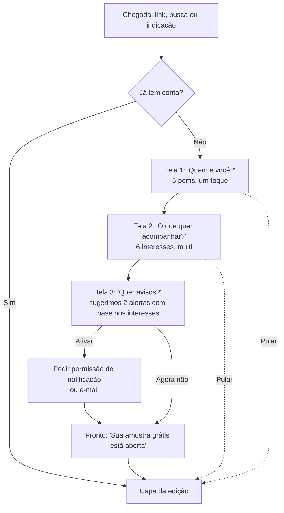
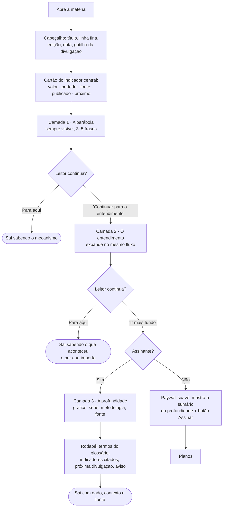
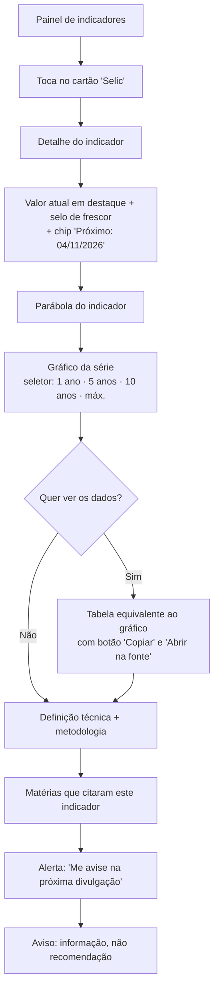
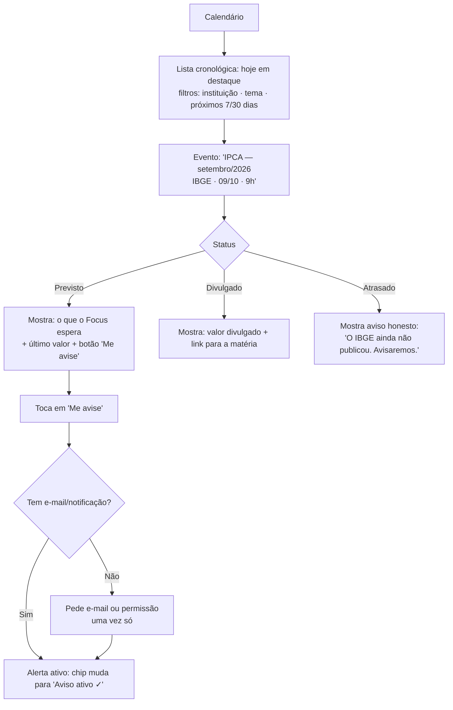
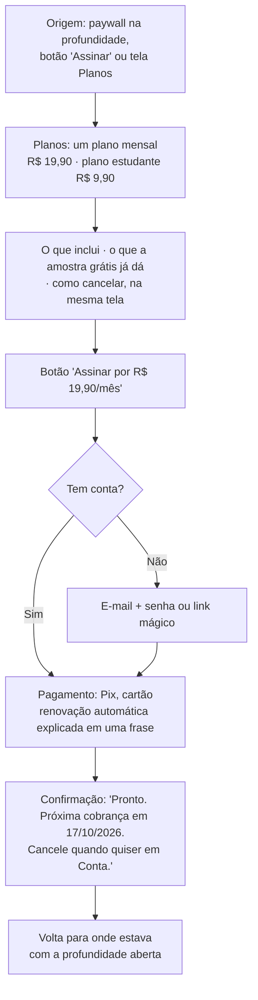
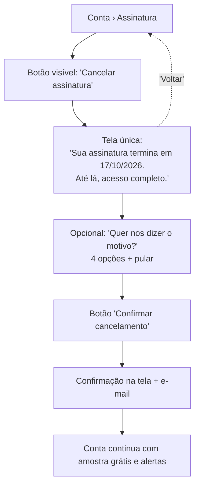

# 04 · Fluxos

Diagramas em Mermaid. Cada fluxo indica o ponto em que o leitor pode parar e ainda sair com algo útil.

## 1. Onboarding (menos de 1 minuto)



Regras: nenhuma etapa pede cartão, CPF ou senha. E-mail só é pedido quando o leitor ativa um alerta ou assina. "Pular" sempre visível.

## 2. Ler uma matéria (três camadas)



Comportamentos:
- O botão de cada camada mostra o tempo estimado ("+2 min", "+5 min").
- Ao expandir, a rolagem continua naturalmente; o título da camada fica fixo no topo enquanto ela é lida (indicador de posição).
- Um controle "Mostrar tudo" no cabeçalho abre as três camadas de uma vez (para quem já conhece o formato).
- Termos técnicos aparecem com sublinhado pontilhado; toque abre a gaveta do glossário sem sair da matéria.

## 3. Explorar um indicador



## 4. Seguir o calendário de lançamentos



## 5. Configurar alertas

```mermaid
flowchart TD
    A[Conta › Alertas] --> B[Lista de indicadores com interruptor]
    B --> C[Para cada um: 'Aviso na divulgação'<br/>e opcional 'Lembrete no dia anterior']
    C --> D[Canal: notificação · e-mail · ambos]
    D --> E[Horário silencioso: não avisar entre 22h e 7h<br/>ativo por padrão]
    E --> F[Salvar]
    F --> G[Confirmação: 'Você será avisado(a) de 3 divulgações<br/>nos próximos 30 dias']
```

Regras: nenhum alerta é ativado sem ação do leitor; desligar é um toque; o produto nunca envia alerta promocional pelo mesmo canal dos alertas de dados.

## 6. Assinar



## 7. Cancelar (simples e honesto)



O que **não** existe neste fluxo: segunda tela de confirmação, oferta de desconto, ligação obrigatória, contagem regressiva, botões com hierarquia invertida.

## 8. Dia de divulgação (visão de sistema)

```mermaid
sequenceDiagram
    participant Cal as Calendário oficial
    participant Col as Coletor de dados
    participant Ed as Redação
    participant App as Produto
    participant L as Leitor

    Cal->>Col: 09/10 09:00 — IPCA setembro publicado (SIDRA)
    Col->>Col: Busca tabela 1737, valida período e publicação
    Col->>App: Atualiza indicador (valor, período, publicadoEm, próxima)
    App->>L: Alerta 'Saiu o IPCA: 0,28 % em setembro' (se ativo)
    Ed->>App: Publica matéria (parábola + entendimento) em até 30 min
    Ed->>App: Publica profundidade (gráficos, comparação) em até 2 h
    App->>L: Matéria atualizada; capa da edição ganha destaque
    App->>App: Marca evento como 'divulgado' e agenda o próximo (IPCA outubro, 10/11)
```
